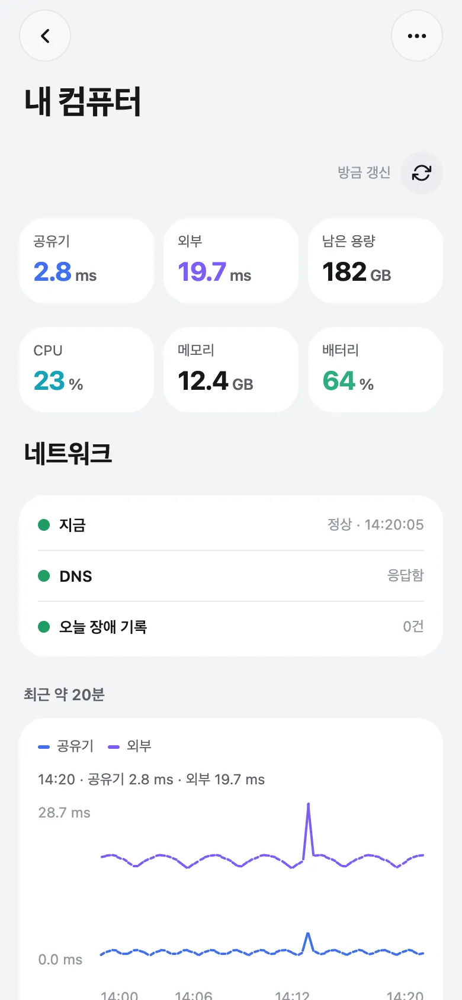
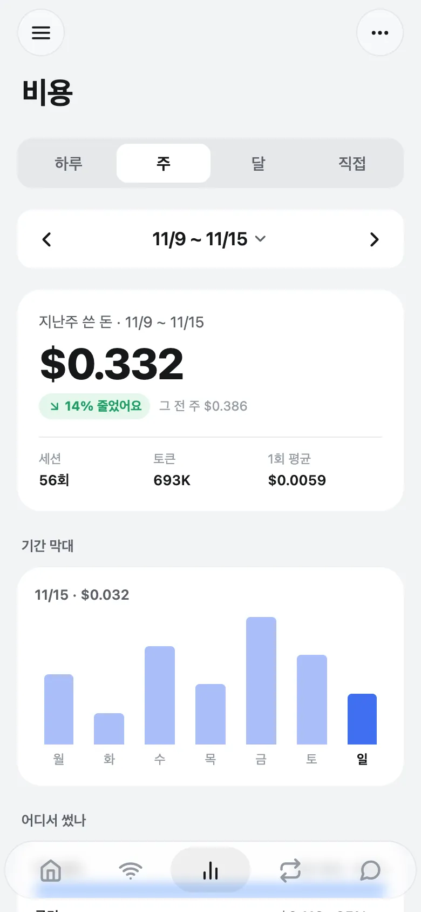
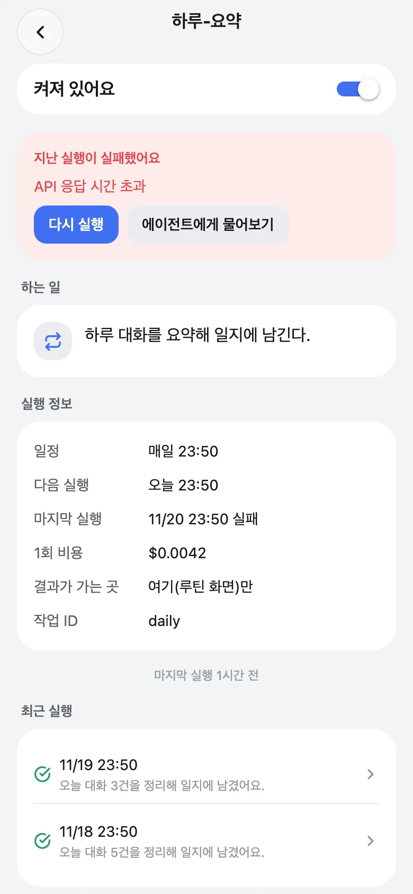
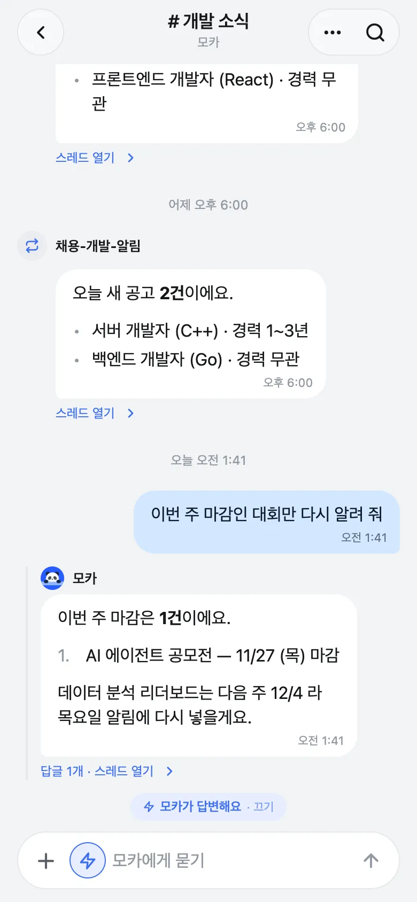

<div align="center">


# 곁

[English](README.md) · **한국어**

**보고 싶은 것만, 한 화면에.**

내 컴퓨터에서 도는 에이전트에게 말하면 원하는 지표가 폰에 탭으로 생겨요.

[웹사이트](https://kyeot.app) · [설치 안내](https://kyeot.app/guide/) · [문서](docs/connect-your-agent.ko.md) · [지원](https://kyeot.app/support)

[](LICENSE)

<br>

   

</div>

## 설치

맥이나 리눅스(arm64, x86_64) 터미널에 붙여 넣으세요. 윈도우는 아직 지원하지 않아요.

```sh
curl -fsSL https://kyeot.app/install | sh
```

실행하면 터미널에 QR이 떠요. 곁 앱으로 찍으면 폰과 이 컴퓨터가 이어지고, 에이전트는 앱에서 붙여요. 같은 컴퓨터의 Hermes는 「연결하기」 한 번, 다른 컴퓨터는 앱이 알려 주는 명령 한 줄이면 돼요.

<!-- 앱스토어 승인 뒤: 곁 앱은 [App Store](APP_STORE_URL)에서 받아요. -->

| 다음에 할 일 | 명령 |
|---|---|
| 로그인할 때 저절로 켜기 | `kyeot service install` |
| QR 다시 보기 | `kyeot pair` |
| 업데이트 | 0.1.6 부터는 `kyeot update`, 0.1.5 이하는 설치 명령을 다시 실행해요. 데이터와 서비스 설정은 그대로 남아요 |
| 잘 깔렸는지 보기 | `kyeot version` |

설치 안내와 `kyeot` 명령은 터미널 언어를 따라가요. 한국어가 아니게 나오면 `curl -fsSL https://kyeot.app/install | KYEOT_LANG=ko sh` 로 실행하세요.

## 이런 걸 해요

| | |
|---|---|
| **말로 내 화면 만들기** | 「내 컴퓨터 상태 탭 만들어 줘」 하면 에이전트가 숫자와 그래프, 표로 화면을 짜 줘요 |
| **견본 하나로 바로** | 비용, 내 컴퓨터, 습관, 할 일 같은 견본을 고르면 탭이 생겨요 |
| **루틴을 한눈에** | 켜고 끄고, 다시 돌리고, 실패하면 이유까지 바로 봐요 |
| **주제별 방** | 루틴 결과가 방에 쌓이고, 그 방에서 물으면 그 주제로 답해요 |
| **대화와 승인** | 에이전트와 이야기하고, 에이전트가 묻는 것을 같은 앱에서 허락해요 |

## 어떻게 이어지나요

```
곁 앱 (폰)
   │
곁 서버 — 이 저장소. 내 컴퓨터에서 도는 kyeot 하나 + SQLite
   │
내 에이전트 — Hermes 는 기본 내장, 그 밖엔 웹소켓으로 붙는 어떤 프로그램이든
```

이 저장소에는 서버만 있고 폰 앱은 없어요. 제작자가 운영하는 곁 서버도 없어요. 서버는 내 컴퓨터에서 돌면서 대화와 방, 루틴, 탭 화면을 로컬 SQLite DB에 둬요.

## 내 기록은 어디로 가나요

대화와 화면, 비용 기록은 내 컴퓨터의 곁 서버에만 저장돼요. 에이전트가 답을 만들 때는 필요한 내용이 그 에이전트에 내가 고른 모델 회사로 가요.

기본 설정에서 서버는 7700 포트로 듣고, 이 컴퓨터와 Tailscale, 같은 Wi-Fi 같은 사설망에서 오는 요청만 받아요. 공인 주소에서 오면 403으로 막아요. 업데이트는 내가 정해요. 백업과 https 같은 자세한 내용은 [docs/self-host.ko.md](docs/self-host.ko.md)에 있어요.

## 내 에이전트 붙이기

웹소켓 규약을 따르는 프로그램이면 무엇이든 에이전트가 돼요. 계약은 메시지 세 가지예요. 답은 `message`, 끝은 `task.end`, 물을 때는 `approval`.

| 문서 | 내용 |
|---|---|
| [connect-your-agent.ko.md](docs/connect-your-agent.ko.md) | 규약 |
| [agent-ui.ko.md](docs/agent-ui.ko.md) | 앱에 탭 화면 그리기 |
| [self-host.ko.md](docs/self-host.ko.md) | 서버 운영 |
| [push.ko.md](docs/push.ko.md) | 휴대폰 알림 |

Hermes 어댑터는 서버에 들어 있어요(`internal/hermesbridge`).

## 소스로 빌드하기

Go가 필요해요(판은 `go.mod`). cgo는 쓰지 않아요.

```sh
go build ./cmd/kyeot
./kyeot
go vet ./... && go test ./...
```

<details>
<summary>내려받는 파일</summary>

[Releases](https://github.com/kyeotapp/kyeot/releases)에 판마다 올라가요. 설치 명령이 알아서 골라 받아요.

| 파일 | 내용 |
|---|---|
| `kyeot_darwin_arm64`, `kyeot_darwin_amd64` | 맥 (Apple Silicon, Intel) |
| `kyeot_linux_arm64`, `kyeot_linux_amd64` | 리눅스 |
| `install.sh` | 설치 스크립트. `checksums.txt`의 서명을 확인하고, 받은 파일이 체크섬과 다르면 깔지 않아요 |

</details>

## 기여와 보안

기여 방법은 [CONTRIBUTING.ko.md](CONTRIBUTING.ko.md)를 보세요. 보안 문제는 공개 이슈 말고 [SECURITY.md](SECURITY.md)에 적힌 방법으로 알려 주세요.

## 라이선스

서버는 [GNU Affero General Public License v3.0](LICENSE)으로 공개해요. 「곁」「kyeot」 이름과 곁 로고는 상표이고, AGPL은 상표를 쓸 권리를 주지 않아요.
