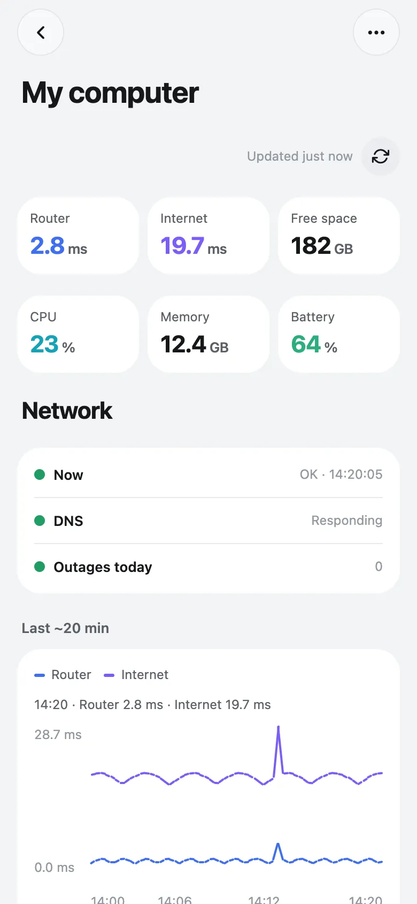
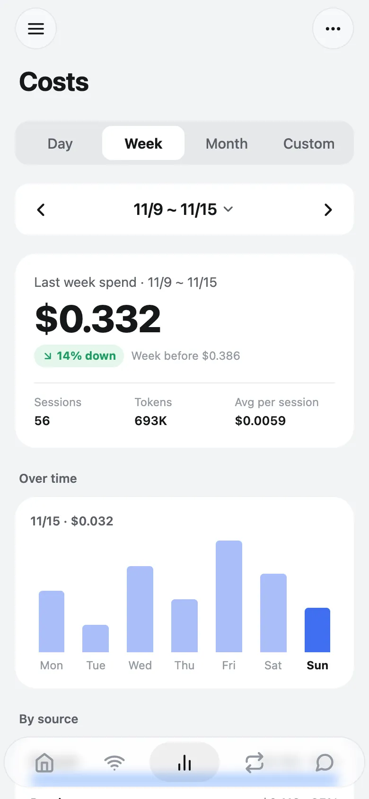
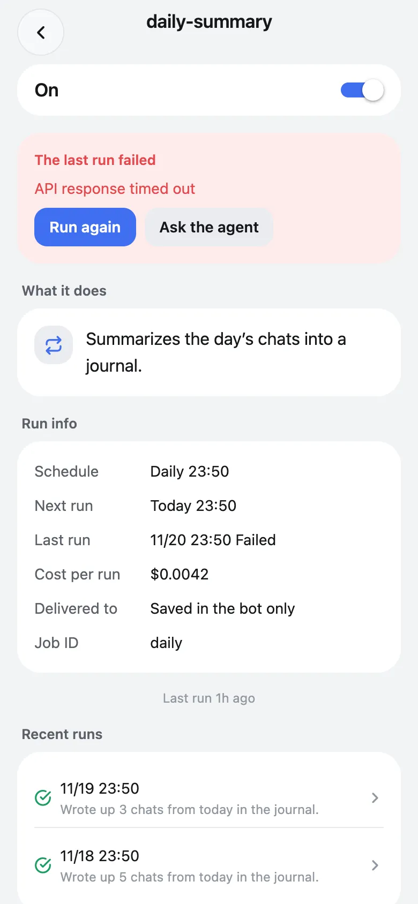
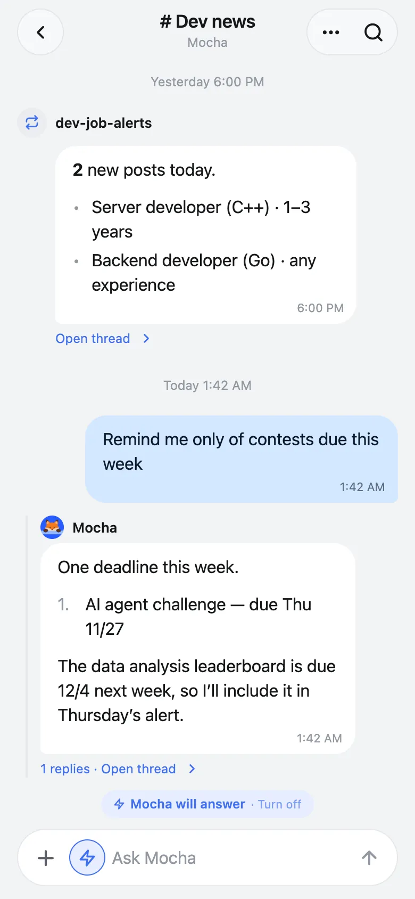

<div align="center">


# Kyeot

**English** · [한국어](README.ko.md)

**Only what you want to see, on one screen.**

Tell the agent on your computer what you want to track, and it becomes a tab on your phone.

[Website](https://kyeot.app) · [Install guide](https://kyeot.app/en/guide/) · [Docs](docs/connect-your-agent.md) · [Support](https://kyeot.app/en/support)

[](LICENSE)

<br>

   

</div>

## Install

macOS or Linux (arm64, x86_64). Windows is not supported yet.

```sh
curl -fsSL https://kyeot.app/install | sh
```

The command prints a QR code. Scan it with the Kyeot app to pair your phone with this computer, then connect an agent from the app: Hermes on the same computer takes one tap, and another computer takes the one-line command the app shows.

<!-- After App Store approval: Get the Kyeot app from the [App Store](APP_STORE_URL). -->

| Next | Command |
|---|---|
| Start at login | `kyeot service install` |
| Show the QR again | `kyeot pair` |
| Update | `kyeot update` (or run the install command again). Your data and service settings stay |
| Check the install | `kyeot version` |

The installer and the `kyeot` commands follow your terminal language. For Korean, run `curl -fsSL https://kyeot.app/install | KYEOT_LANG=ko sh`.

## What it does

| | |
|---|---|
| **Build screens by asking** | Say "make me a tab for my computer" and the agent lays out numbers, charts and tables |
| **Start from a template** | Pick costs, my computer, habits, to-dos and more to get a tab right away |
| **Routines at a glance** | Turn them on and off, rerun them, and see why a run failed |
| **Topic rooms** | Routine results collect in a room; ask there and the answer stays on topic |
| **Chats and approvals** | Talk to the agent and approve what it asks, in the same app |

## How it fits together

```
Kyeot app (phone)
   │
Kyeot server — this repo. One kyeot binary + SQLite on your computer
   │
Your agents — Hermes built in, or any program over WebSocket
```

This repository is the server only. The phone app is not in it. There is no hosted Kyeot service: the server runs on your computer and keeps conversations, rooms, routines and tab screens in a local SQLite database.

## Where your data goes

Conversations, screens and cost records are stored only in the Kyeot server on your computer. When the agent writes an answer, what it needs goes to the model provider you chose for that agent.

By default the server listens on port 7700 and accepts only this computer, Tailscale and your private network such as the same Wi-Fi; public addresses get 403. You decide when to update. Details, including backups and HTTPS, are in [docs/self-host.md](docs/self-host.md).

## Connect your own agent

Any program that speaks the WebSocket protocol can be an agent. The contract is three messages: reply with `message`, finish with `task.end`, ask with `approval`.

| Doc | |
|---|---|
| [connect-your-agent.md](docs/connect-your-agent.md) | The protocol |
| [agent-ui.md](docs/agent-ui.md) | Drawing tabs in the app |
| [self-host.md](docs/self-host.md) | Running the server |
| [push.md](docs/push.md) | Phone notifications |

The docs are in Korean. A Hermes adapter is built in (`internal/hermesbridge`).

## Build from source

Requires Go (see `go.mod` for the version). No cgo.

```sh
go build ./cmd/kyeot
./kyeot
go vet ./... && go test ./...
```

<details>
<summary>Release files</summary>

Each version is published under [Releases](https://github.com/kyeotapp/kyeot/releases). The install command picks the right one.

| File | |
|---|---|
| `kyeot_darwin_arm64`, `kyeot_darwin_amd64` | macOS (Apple Silicon, Intel) |
| `kyeot_linux_arm64`, `kyeot_linux_amd64` | Linux |
| `install.sh` | Installer. Verifies the signature on `checksums.txt` and refuses files that do not match |

</details>

## Contributing and security

See [CONTRIBUTING.md](CONTRIBUTING.md) to contribute. Report security issues as described in [SECURITY.md](SECURITY.md), not in public issues.

## License

The server is licensed under the [GNU Affero General Public License v3.0](LICENSE). The names "곁" and "kyeot" and the Kyeot logo are trademarks; the AGPL does not grant permission to use them.
